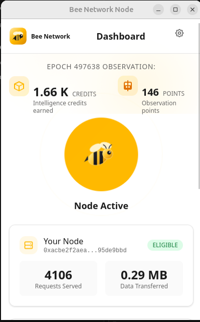

# Bees Network — Spark Program application

Application for the Nervos **Spark Program** (mini-grant): **Bees Network**, a decentralized observation layer for AI agents on CKB.

- **Proposal:** [APPLICATION.md](./APPLICATION.md)
- **Project repo:** https://github.com/NOrththebear/Bees-Network
- **Live release:** https://github.com/NOrththebear/Bees-Network/releases/tag/v0.1.0

## Live MVP

Applicant: North Bear · Discord `northbears`
